# Play test 0001: First prototype

This is the report of the tests of [plan 0001](../plans/0001-first-prototype.md), section 5.

## Summary

| Target | Result | Met |
|---|---|---|
| `mix test` shows the 5 results of section 5.1 | 39 tests, all pass | Yes |
| The TLA+ contracts of the world hold in all the states of their models | 4 models, 24,359 states | Yes |
| Tick time, 95th percentile, 50 ms or less (1,000 workers, 20 clients) | 2.1 ms | Yes |
| Each client gets 30 KB each second or less | 6.4 KB | Yes |
| Cross the gap alone and touch the food in less than 4 minutes | 2 min 8 s, with 19 bodies | Yes, but see "Limits" |
| First load 500 KB or less after compression | 43 KB | Yes |
| 30 frames each second on a phone with 1,000 bodies | Not measured | See "Limits" |

All the tests of section 5 are done. No target failed. Two targets need a person and a real
phone, and I cannot say that they are met: see "Limits".

## Limits of these tests

Read this first. It tells what the numbers below do not show.

- **A script played, not a new person.** The scripts in `test/play/` open the page in
  Chromium and play with real touch events (390 x 844) and real key events (1280 x 800).
  The script knows the rules. It does not stop to think, and nothing confuses it. Thus its
  times are the shortest times that are possible, not the times of a new player.
- **The test machine has no graphics card.** Chromium draws with software there. The
  frame rates in the screenshots (6 to 30 frames each second) tell nothing about a phone.
- **I did not measure a real phone.** Open the page with `?stats=1` on the phone. For
  1,000 bodies, start the server with `COLONY_WORKERS=1000` and open `?demo=1&stats=1`.
- **"Lock my first body in less than 60 seconds with no instructions"** (section 8) is a
  test for a person. The script locks its first body 5.8 seconds after the load.

## 5.1 Automatic tests

`mix test` runs the world with no browser: 39 tests in 32 seconds, all pass. 14 of them
are the tests of the TLA+ contracts: see "TLA+ contracts" below.

| Result of the plan | Test | What the test shows |
|---|---|---|
| 1. One cell wide stops at 7 rows | `test/bridge_test.exs` | The supports are 7, 6, 5, 4, 3, 2, 1. No body can lock in row 8. |
| 1. Two cells wide crosses 12 rows | `test/bridge_test.exs` | 24 bodies, all with support. The player then walks across and touches the food. |
| 2. Bodies that lose their support fall also | `test/bridge_test.exs` | Without row 3 of 7, rows 4 to 7 fall. A second test shows a fall that causes a second fall through the cost. |
| 3. 200 workers build a bridge and bring food in less than 5 minutes | `test/workers_test.exs` | The bridge is complete after 5.0 s with 19 bodies. The first food is at the nest after 11.4 s of world time. |
| 4. All locked workers let go; bodies of players stay | `test/workers_test.exs` | After the scent is gone, no worker is locked. Three bodies of a player at the bank stay with support 7, 6, 5. A body of the player on the bridge of the workers falls. |
| 5. Save and load give the same world | `test/save_test.exs` | The seed, the locked bodies with names and times, the scent, the food, the supports. |

Other tests: the grid, a body that cannot go into the gap, the new body one second after a
lock, a free body on a body that falls, workers with no scent that stay near the nest, and
a client that reads the binary messages for 1,500 ticks and stays equal to the world.

## 5.2 Load test

`mix colony.load`: 1,000 workers and 20 clients for 5 minutes at 10 ticks each second, on
a machine with 4 cores. The scent of the demo mode was on: the workers built a bridge and
carried food all the time. Each client was a real WebSocket connection that moved 10 times
each second.

| Measure | Result | Target |
|---|---|---|
| Ticks of the server | 3,000 in 300.0 s (10.0 each second) | 10 each second |
| Tick time, median | 1.21 ms | |
| Tick time, 95th percentile | 2.06 ms | 50 ms or less: **met** |
| Tick time, 99th percentile | 2.69 ms | |
| Tick time, maximum | 7.05 ms | |
| Memory of the VM, maximum | 98.4 MB | |
| Memory of the world process | 4.5 MB | |
| Bytes each second for each client | 6,400 (all clients get the same data) | 30,000 or less: **met** |
| Ticks each second that a client got | 10.0 | |

The tick uses about 2% of its 100 ms. The bytes are 21% of the target. A later plan has
room for more bodies and more players.

After the change of the move rule (see "TLA+ contracts"), a run of 60 seconds gave the
same numbers: 95th percentile 2.2 ms, and 6.6 KB each second for each client.

## 5.3 Play test

### 1. With 0 workers, cross the gap alone and touch the food

Phone size, touch events. Server: `COLONY_WORKERS=0`, new world.

| Measure | Result |
|---|---|
| First lock | 5.8 s after the load |
| A bridge one cell wide stops | at 7 rows |
| Bodies in the complete bridge | 19 |
| Bridge complete | 1 min 58 s |
| **At the food** | **2 min 8 s** (target: less than 4 minutes) |
| Moves that the server refused | 0 |

Other runs on the same machine took 2 min 2 s and, with a slower picture, 2 min 52 s. A person
needs more time than the script: I expect 3 to 4 minutes for a player who knows the rule,
and more for a new player. The target is not safe for a new player.

The script plays this way: go to the end of the bridge and lock in the next row. If that
is not possible, lock beside the body that is nearest to the end and alone in its row.

| | |
|---|---|
| 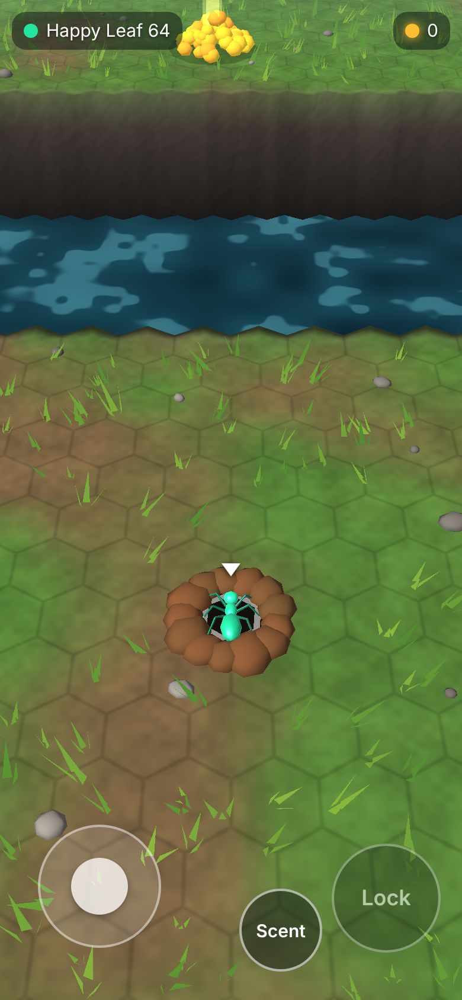 The start: the nest, the gap and the food. | 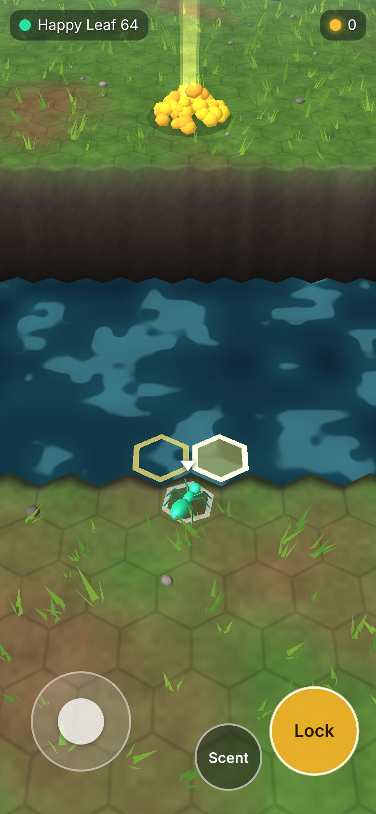 At the gap: the cells where a lock is possible, and the bright button. |
| 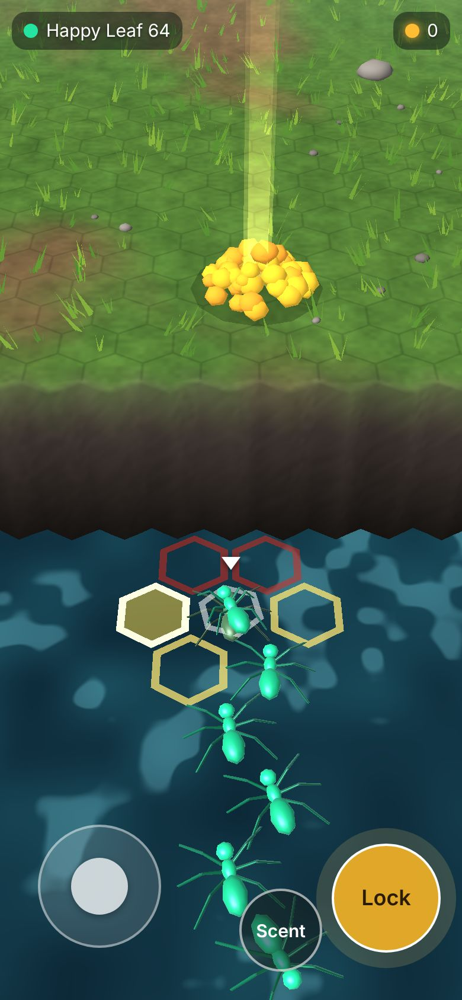 Row 7: a lock is not possible in the red cells. | 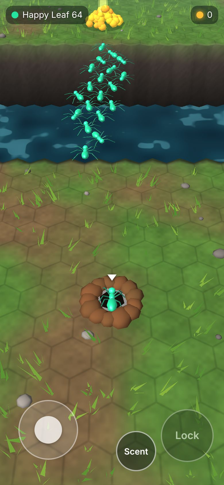 The complete bridge, from the nest. |

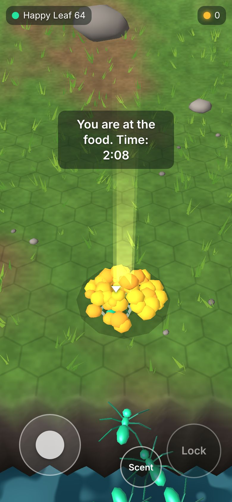

### 2. With 200 workers, put scent from the nest to the gap

Desktop size, key events. I held Shift and W from the nest to the gap. I did not lock.

| Measure | Time after the load |
|---|---|
| The scent is at the gap | 3.0 s |
| First lock of a worker | 5.5 s |
| The bridge of the workers is complete (19 bodies) | 5.9 s |
| **First unit of food at the nest** | **12.4 s** |

About one minute later the pile of 500 units was empty.

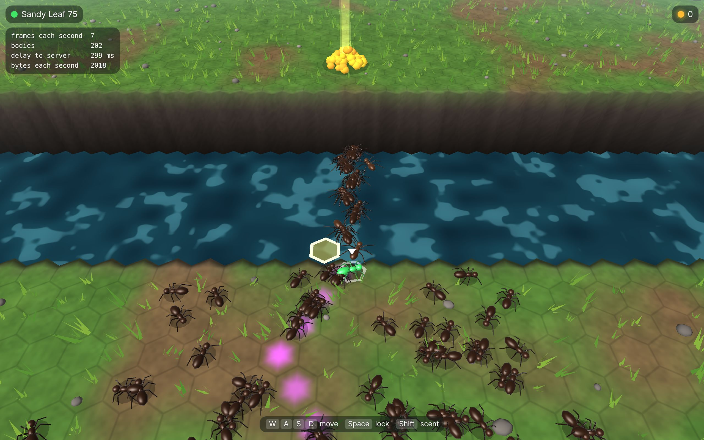
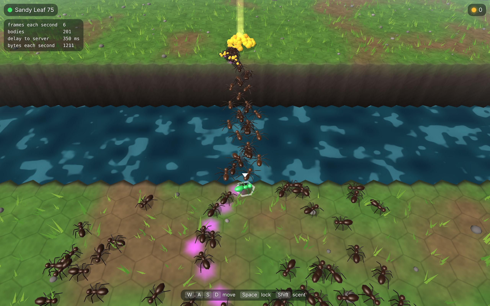
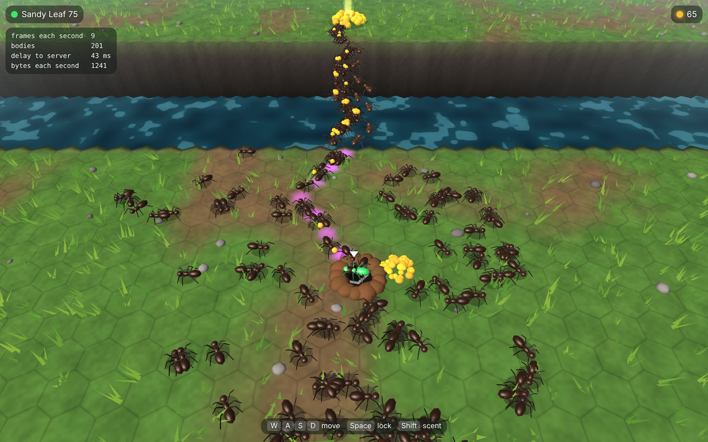

### 3. Two browsers in one world

One browser at desktop size and one at phone size, in the world of test 2. Each player
locked 2 bodies at the bank.

- The two browsers had the same 23 locked bodies: the same cells, names, times and
  supports.
- Each browser showed the 2 bodies of each player with the correct name.
- Each browser showed the free body of the other player, with its name above it.
- On the phone, a tap on a body of the desktop player showed its name and time.

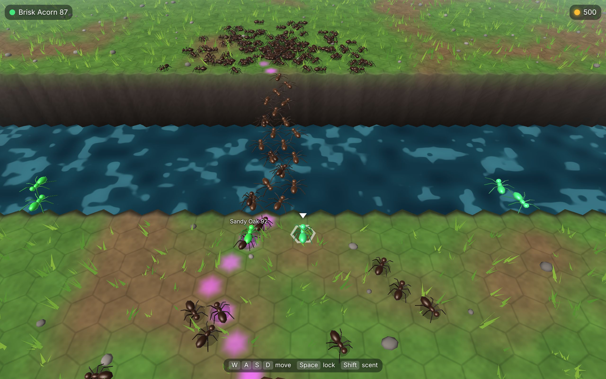
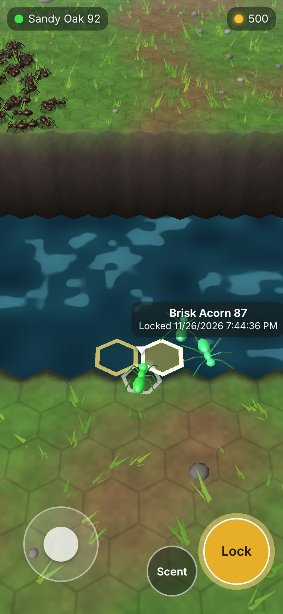

### 4. Load the page again

The world was the same: the 23 locked bodies with names and times, the food at the nest
(500) and the scent (23 cells). The name of the player was the same: it comes from local
storage.

### 5. Start the server again

I stopped the server with the signal `TERM` and started it again.

- The server saved the world when it stopped, and loaded it at the start.
- The 4 locked bodies of the players were there, with the same names and times.
- The locked workers and the food at the nest were there.
- A tap on a body showed the name of the player who locked it before the restart.

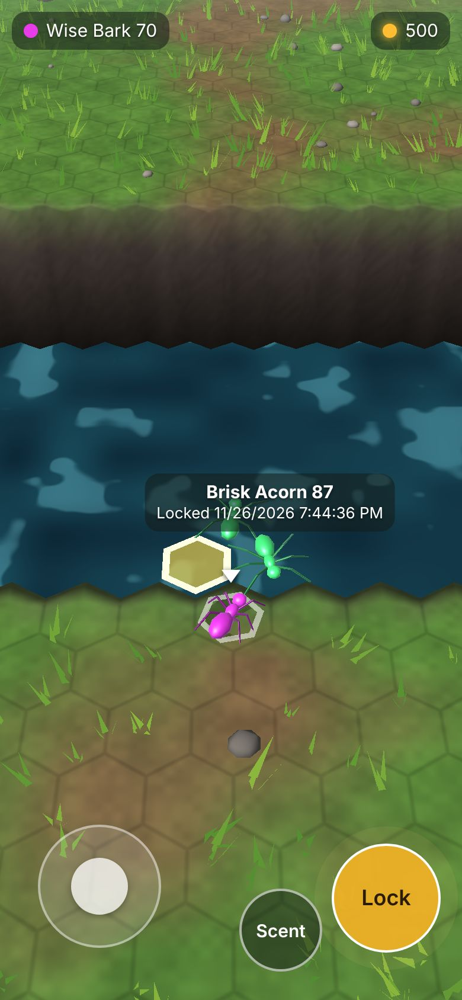

The first run of this test **failed**: see fault 2 below.

## TLA+ contracts

After the tests above, I wrote the rules of the world as contracts in TLA+, in
[`specs/`](../../specs/README.md). The native TLA+ checker of
[accord](https://github.com/sntran/accord/tree/feat/native-tla-checker) checks them. Java
is not necessary.

### The checker looks at all the states of each model

| Model | States | Time | Result |
|---|---|---|---|
| `Bridge`: a gap 2 cells wide and 3 rows | 593 | 4 s | All rules hold |
| `BridgeOneWide`: the numbers of the plan, one cell wide | 255 | 5 s | No body after row 7 |
| `Colony`: the small gap and one player | 6,094 | 42 s | All rules hold |
| `BridgeWide`: a gap 3 cells wide and 3 rows | 17,417 | 223 s | All rules hold |

The rules that hold in each state:

- Each locked body has support.
- The fast calculation of the support in the server gives the same number as the full
  calculation.
- A new body never makes a body fall.
- A locked body of a player goes away only when it has no support.
- A free body is never in the gap with no locked body below it.
- A player loses a body only by a lock or by a fall, and a new body starts at the nest.

For "a bridge one cell wide stops at 7 rows", the checker shows the two parts: no state
has a body after row 7, and a state with a body in row 7 exists. It also reports the
bridge of 7 bodies of a player as a state with no next step. That is the result of the
plan, said by the checker.

### The real world against the contract

- **The monitor.** `Accord.Spec.Monitor` is between a test player and a real world. Two
  players send 300 random messages in each of 6 runs. Three workers build, let go and
  fall. Each message, each reply and each event must be a step of `Colony.tla`. After
  each message, the monitor compares the locked bodies and the body of each player with
  the contract. All the runs have no violation.
- **A wrong world.** A test gives the world a bank support of 3.0 where the contract says
  2.0. The monitor reports the first wrong lock and blames the server.
- **200 workers on the grid of the game.** The scent starts, stops and starts again. The
  workers made 103 locks and let go 15 times. Each one is a step of the contract, and the
  bodies of the world are the bodies of the contract after each step.
- **A bridge two cells wide.** The contract permits the 24 locks across the 12 rows, with
  the numbers of the plan.

### A fault that the monitor found

**A body could jump across a cell.** In the first run of the monitor, the world said
"ok" to a move from the nest to a cell two rows away, across a cell where a body cannot
be. The contract says "no", and the monitor blamed the server. The world looked only at
the end of a move and at its length. A changed client could jump across a hole of one
cell in a bridge.

Now the world looks at points along the straight way of each move, and a body can keep
less movement for later. In play test 1, after this change, the server refused no move
of the player.

### Faults that the work found in the checker tools

- `mix accord.check --extra` does not read `CHECK_DEADLOCK FALSE` from the config file:
  `Accord.TLA.Engine` sets the deadlock check to "on" when the caller gives no option.
  `Accord.TLA.Checker.check/2` reads the line correctly. `mix colony.contracts` uses the
  checker directly.

## The other modes

- `?stats=1` shows the frames each second, the number of bodies, the delay to the server
  and the bytes each second. The screenshots of test 2 show it.
- `?demo=1`: from a new world, the bridge is complete after 6 seconds, and 150 to 190
  units of food are at the nest after 28 seconds. The camera goes from the nest to the gap.

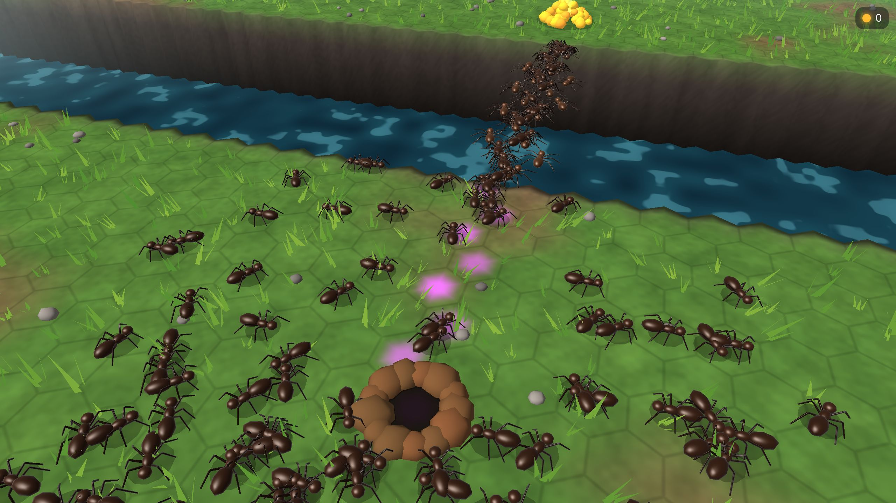
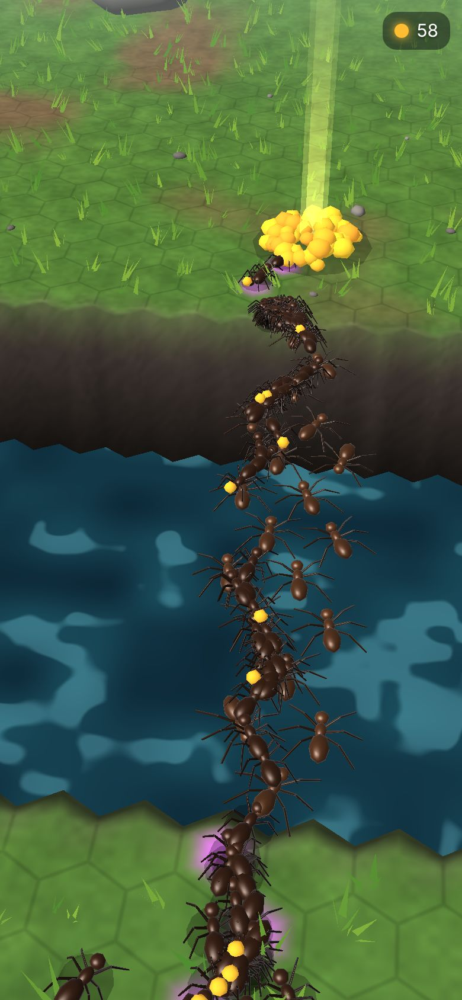

- With 1,000 workers the page works and shows no errors. A client got 4.3 KB each second.

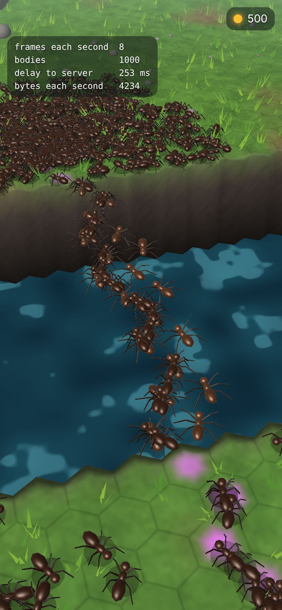

- The first load is 43 KB after compression: one HTML file (2 KB), 8 JavaScript files of
  the game (27 KB) and the channel client of Phoenix (14 KB).
- When the server stops and starts, the page connects again in about 1 second and gets
  the world. The player gets a new body at the nest.

## Faults that I found and repaired

1. **The body stopped at a corner of a bridge.** On a bridge one cell wide, the way goes
   from side to side. The body of the player stopped at the corner between two cells and
   did not continue. Play test 1 stopped there. The body now slides along the edge.
2. **A restart lost the world.** The server could not read a save file that had locked
   bodies, and it started a new world. The file reader accepts only names that the VM
   knows, and in development the VM did not know the names `worker` and `player` at that
   moment. Play test 5 found this. The store now makes sure that the VM knows the names,
   and a test checks the list.
3. **`mix phx.server` did not listen.** A line `server: false` in the config stopped the
   listener. I removed it.
4. **A slow frame made the body slow.** The page limited the time of one frame to 50 ms.
   At 5 frames each second the body moved at a quarter of its speed. The body now moves
   with the real time, in small steps.
5. **The ground did not draw.** The index buffer of the water replaced the index buffer
   of the ground in the graphics card. Chromium gave a warning for each frame.
6. **The page files had no compression.** I made a plug that sends them with gzip.
7. **The player could not find the body.** With 200 workers near the nest, the body of
   the player was one of many. It now has a white triangle above it and a ring below it.
8. **Low support did not show for a red player.** A body with low support was red. A
   player with a red color saw no difference. The body now goes red and back, again and
   again, and shakes more.
9. **The picture was slow.** With 200 workers at desktop size, the test machine drew 3
   frames each second. Now it draws 23. Three changes: the grass and
   the stones are one shape, the page calculates each sine one time for a body and not for
   each vertex, and a screen with many pixels gets no smooth edges from the graphics card.
   I expect that these changes help a phone also.

10. **A body could jump across a cell.** The TLA+ monitor found this: see "TLA+
    contracts".

## Things that can confuse a new player

Most important first.

1. **Why does the bridge stop?** At row 7 the cells in front get a red outline, and the
   last bodies shake and go red. Nothing tells the player that a body beside a body makes
   the bridge stronger. The yellow outlines beside the bridge are the only hint. I think
   that this is the largest risk for "cross the gap with no instructions".
2. **A lock that does not help.** A player can lock a third and a fourth body beside the
   same row. They give no support to the next row. In the first run of play test 1, the
   script used a bad rule and made a row 5 bodies wide. A new player can do the same.
3. **The best place to make the bridge wider is not clear.** A second body in a row gives
   0.5 to all the rows after it. Thus a second body near the bank helps more than one near
   the end, where the red cells are.
4. **Which cell gets the body?** The page selects the cell in the direction that the body
   looks. With two possible cells, the player must push the stick a small quantity to
   select the other cell. The full bright cell shows the selection, but a quick player can
   lock into the wrong cell.
5. **Where is my body after a lock?** The camera goes back to the nest in one second.
   There is no sign that tells "this is your new body", only the white triangle.
6. **What does Scent do?** With no workers, the button only makes pink spots. With
   workers, the effect is fast and large: 200 workers go to the gap and build a bridge in
   3 seconds. Nothing tells the player before the first try.
7. **Workers take the cell that I want.** Near scent, a worker can lock into the cell
   that the player selected, a moment before the player. Play test 3 showed this: the
   lock of the player then fails, and the button shakes, with no reason given.
8. **A bridge of workers can go away below me.** A locked worker lets go after 20 seconds
   with no use. A player who stands on the bridge keeps the bodies near. But bodies far
   behind can let go, and then the bodies below the player fall. The page shows "You
   fell", and the player starts at the nest.
9. **The bridge becomes thin.** When a bridge touches the far bank, it gets support from
   the two banks. A bridge one cell wide can then stay, and the extra workers let go. The
   bridge that a player sees gets smaller with no clear cause.
10. **The number at the top right has no label.** It is the food at the nest. The pile
    becomes full again after 60 seconds, and the number has no end. It is only a goal.
11. **I touch the food and get nothing.** A player does not carry food. The page shows a
    message with the time, and that is all.
12. **Workers wait on the far bank.** When the pile is empty, hundreds of workers stay
    near the place of the food. It can look as if they cannot come back.
13. **Stones look like obstacles.** A body goes through them.
14. **The end of the world has no wall.** At the left and the right the body stops, and
    the ground has no cell lines there. There is no other sign.
15. **The name of a body shows only after a tap.** On a phone a body is a small target,
    and a tap between two bodies shows nothing.

## What the prototype tells me about the three questions

1. **Is it fun for one player to lock bodies and cross a gap?** The tests cannot answer
   this. They show that the loop works and is short: go to the gap, lock, start again,
   about 6 seconds for each body. The rule of support makes one real problem to solve at
   row 7. A person must play to answer the question.
2. **Can workers build a bridge with a few simple rules?** Yes. With the rules of the
   plan, 200 workers complete a bridge of 19 bodies in 3 seconds after they get to the
   gap. I think that 19 is the smallest number that the support rule permits. They build
   too fast for
   a player to help: this is a point for the next plan.
3. **Can the server hold 1,000 bodies at 10 ticks each second?** Yes, with much room: 2%
   of the tick time and 21% of the bytes. **Can a phone draw them?** I do not know. The
   page draws all bodies with one draw call and does not draw the bodies that are out of
   the picture. A real phone must give the answer.
