# Play test 0002: The players are the bridge

This is the report of the tests of
[plan 0002](../plans/0002-players-are-the-bridge.md), section 5.

## Summary

| Target | Result | Met |
|---|---|---|
| `mix test` shows the 9 results of section 5.1 | 83 tests, all pass | Yes |
| The TLA+ contracts agree with the new rules | 6 models, 1,306 states, all rules hold | Yes |
| Tick time, 95th percentile, 50 ms or less (1,000 workers, 20 clients, 8 helpers) | 4.7 ms | Yes |
| Each client gets 30 KB each second or less | 7.4 KB | Yes |
| Alone: the first food is at the nest in less than 90 seconds from the load | 17.5 s | Yes, but see "Limits" |
| Alone: cross a place 12 rows wide with 24 bodies or fewer | 22 bodies, in 3 min 45 s | Yes, but see test 1 |
| One player and 3 helpers: the record has the player and helpers | 1 player (3 bodies) and 3 helpers | Yes |
| Two browsers and 2 helpers: one record has the two players, the same in each browser | Yes | Yes |
| Demo mode: the first bridge grows for 15 to 45 seconds, then food goes across | Complete at 26.8 s, first food at 31.3 s | Yes |
| The play session: start the workflow one time and join | **I could not start the workflow** | **No** |

One test is not done: the play session on a runner of GitHub. See test 5. All the other
tests of section 5 are done, and their targets are met.

## Limits of these tests

Read this first. It tells what the numbers below do not show.

- **A script played, not a new person.** The scripts in `test/play/` open the page in
  Chromium at 390 x 844 and play with real touch events. The script knows the rules. It
  does not stop to think, and nothing confuses it. Its times are the shortest times that
  are possible. They are not the times of a new player.
- **No test answers the three questions of section 2.** "Is it fun", "do persons build
  together" and "does a person want to see the record" need persons. The tests show that
  each part works.
- **The play session did not run on GitHub.** The workflow file was never on a runner.
- **The test machine has no graphics card.** Chromium draws with software there. The
  speed of the picture tells nothing about a phone. I did not measure a real phone.
- **All the play tests use one river**, the river of seed 2027. The automatic tests use
  other seeds.

## 5.1 Automatic tests

`mix test` runs the world with no browser: 83 tests in 51 seconds, all pass.

| Result of the plan | Test file | What the test shows |
|---|---|---|
| 1. With scent and no player, no body locks in 5 minutes | `workers_test.exs` | 200 workers and a strong line of scent for 3,000 ticks, with 3 seeds: 0 locked bodies. More than 50 workers wait at the river. |
| 2. One body wide stops at 7 rows, two at 15, three at 23 | `bridge_test.exs` | On a river of 26 rows. A player also builds to row 7 and cannot lock in row 8. |
| 3. The integers give the same result as a full calculation | `bridge_test.exs` | 60 random groups of 50 bodies or fewer. Each support is equal to the support of a slow calculation with fractions. A lock is possible exactly when the slow calculation gives support. A new body never decreases a support. |
| 4. The body of the nearest free worker in the next tick | `bodies_test.exs` | The player has the place of that worker, and the colony has one worker fewer. Nearest is by steps on foot. A worker with food is not used. With no worker: at the nest after 3 seconds. |
| 5. Ten units make one worker. Fewer than 5: one each 10 seconds | `bodies_test.exs` | And 200 workers at most. |
| 6. The loss of a pile, and the next pile at a wider place | `pile_test.exs` | No loss before the first lock. 1 unit each second after it. The widths of the piles are 5 or 6, then 9, 12, 14 and 16. A new pile is 8 columns or more from each complete bridge. |
| 7. A record has the correct names, numbers and times | `pile_test.exs`, `save_test.exs` | Two players and a helper in one bridge. A fast bridge gives more food than a slow bridge. Save and load keep the records and the counts of the bodies. |
| 8. Four helpers: first bridge in less than 60 seconds, food across 12 rows in less than 5 minutes | `helpers_test.exs` | First bridge after 22.8 s with 6 bodies, first food 4.0 s later. 12 rows: the bridge after 75.7 s with 19 bodies, first food after 82.4 s. |
| 9. The TLA+ contracts agree with the new rules | `contract_check_test.exs`, `contract_monitor_test.exs` | See "TLA+ contracts". |

Other tests: the river of 40 seeds, the binary messages (a client that reads each tick
stays equal to the world), wrong messages on the channel, and a save file of plan 0001.

## 5.2 Load test

`mix colony.load`: 1,000 workers, 20 clients and 8 helpers for 5 minutes at 10 ticks each
second, on a machine with 4 cores. The helpers built bridges to 5 piles, and the workers
carried food all the time. Each client was a real WebSocket connection that moved 10
times each second.

| Measure | Result | Target |
|---|---|---|
| Ticks of the server | 3,000 in 300.0 s (10.0 each second) | 10 each second |
| Tick time, median | 1.52 ms | |
| Tick time, 95th percentile | 4.71 ms | 50 ms or less: **met** |
| Tick time, 99th percentile | 6.63 ms | |
| Tick time, maximum | 9.35 ms | |
| Memory of the VM, maximum | 62.4 MB | |
| Memory of the world process | 7.3 MB | |
| Bytes each second for each client | 7,364 (all clients get the same data) | 30,000 or less: **met** |
| Ticks each second that a client got | 10.0 | |

At the end the world had 987 free workers, 67 locked bodies, 4 records and 1,109 units of
food at the nest.

The tick uses about 5% of its 100 ms. In plan 0001 it used 2%: the ways of the workers to
the pile and across the bridges are new searches. The bytes are 25% of the target.

## 5.3 Play test

Phone size (390 x 844), real touch events. The left thumb stays on the stick while the
right thumb taps "Lock" or holds "Scent". Fault 1 of section 4.10 made this possible.

### 1. A new player alone

Server: 30 workers, 0 helpers, a new world.

The script plays as the plan says. It pushes forward and taps "Lock" when the button is
bright. If the button is not bright, it tries the two sides, then one step back.

| Measure | Result |
|---|---|
| First lock | 4.6 s after the load |
| After the lock | The player has the body of a worker immediately. The page shows 29 free workers. |
| The first bridge is complete | 13.5 s, 6 bodies across 6 rows |
| The player is at the pile | 15.1 s |
| **First food at the nest** | **17.5 s** (target: less than 90 seconds) |
| The record card | "Bridge 1: 6 rows in 13 seconds", with the name of the player and "6" |
| Moves that the server refused | 0 |

Three runs gave 17.2 s, 17.5 s and 17.5 s.

Then the player went along the near bank to a place 12 rows wide and built there.

| Measure | Result |
|---|---|
| One body wide stops | at row 7. The cells in front get a red outline. |
| **Bodies in the complete bridge** | **22** (target: 24 or fewer). The smallest number is 19. |
| Bodies in each row, from the near bank | 1 1 1 1 1 2 4 3 3 3 1 1 |
| Time for this bridge | 3 min 45 s: about 10 seconds for each body |
| A tap on a body | "Lucky Nettle 90, Locked 11/27/2026 12:13:46 AM, 2 bodies went across" |
| The supports that the page calculates | Equal to the supports of the server, for each body |

**My first run of this part was wrong, and I repaired the test.** The script selected a
column 12 rows wide. But the column beside it was 11 rows wide, and the bridge ended on
that bank: 18 bodies in 11 rows. The script now uses a place where all the columns near
it are 12 rows wide or more, and it makes sure that the bridge has bodies in 12 rows.

**The time for each body is long at a place far from the workers.** The 12-row place of
the last run is 21 columns from the nest. After each lock, the nearest free worker was
often at the first bridge, and the walk back was long. At the place of the wrong run, 6
columns from the first bridge, a body took 3.5 seconds. Scent along the
bank brought only some workers: most of them carried food. This is the rule of section
4.3 at work. A person must tell if it is a good problem or a bad wait.

| | |
|---|---|
| 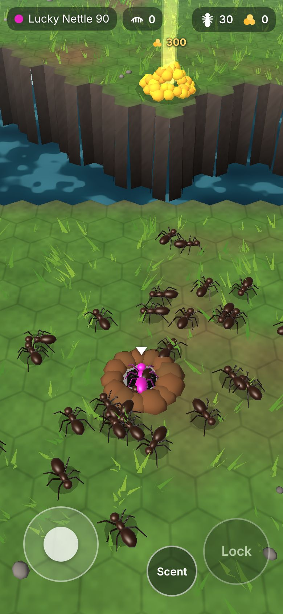 The start: the nest, the river, and the light of the pile. | 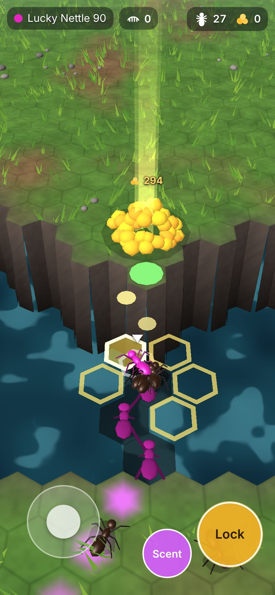 Two bodies are locked. The yellow marks and the green mark show that the bridge gets across. |
| 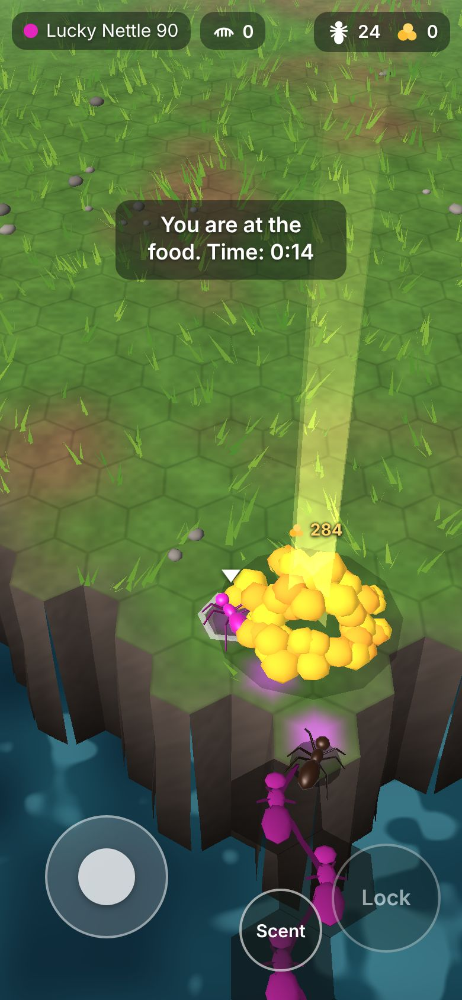 The complete bridge. | 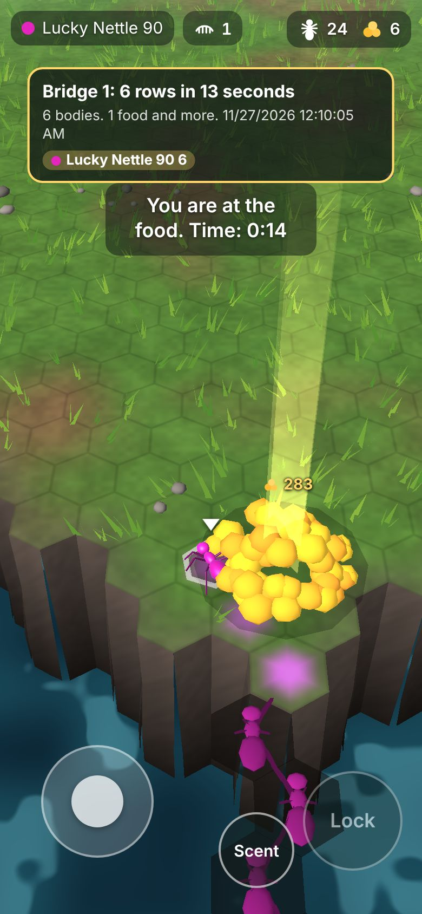 The record card at the first food. |
| 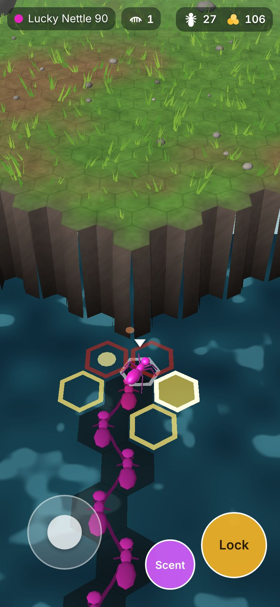 Row 7: a lock is not possible in the red cells. The mark in the cell beside the body shows the new reach. | 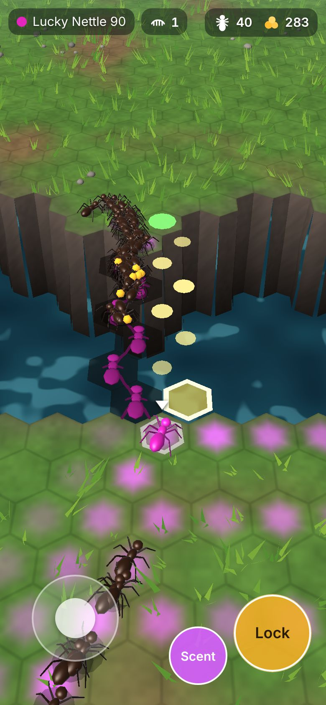 Bodies beside bodies. The legs go to the bodies that they touch. |
| 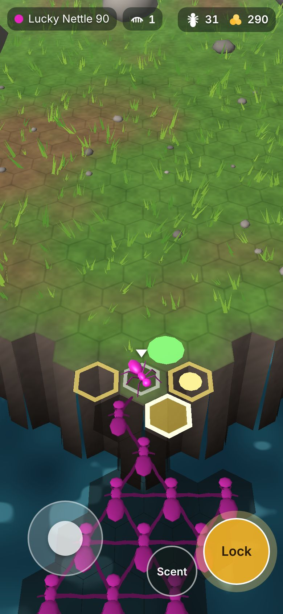 Across 12 rows. | 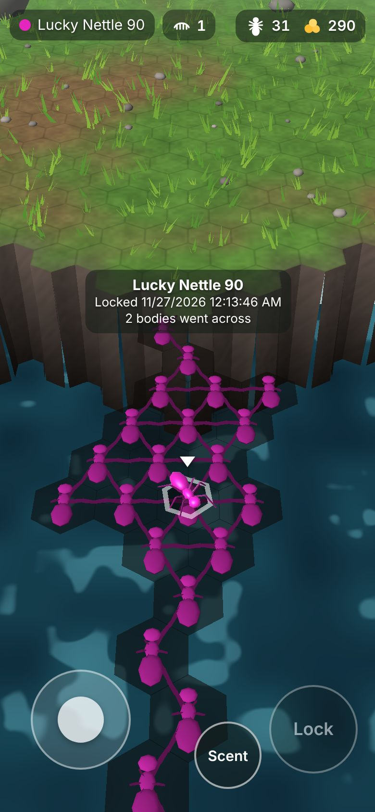 A tap on a body: the name, the time and the count. |

### 2. One player and 3 helpers

Server: 30 workers, 3 helpers. The player locked 3 bodies in the bridge that the helpers
built.

- The record of the bridge: 8 bodies, 7 rows, 26 seconds. The names: the player with 3
  bodies, "Helper 2" with 2, "Helper 3" with 2, "Helper 1" with 1.
- The player saw the record card at the first food.
- The helpers are grey. The label of a helper has a line of dashes around it.

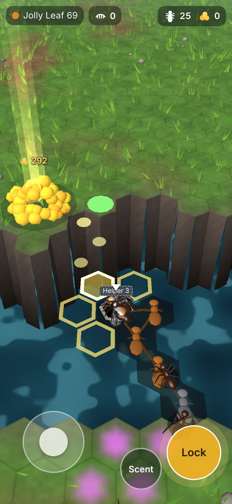
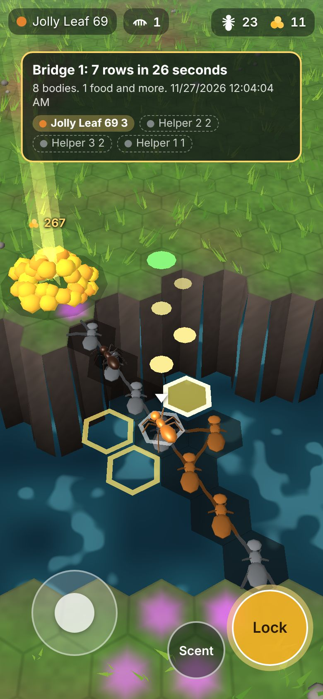

### 3. Two browsers and 2 helpers

Two browsers at phone size in one world. Each player locked 2 bodies. The record counts
the bodies that are in the bridge at the first food. One body of the second player was
not a part of the bridge at that moment.

- One record has the two names of the players: "Helper 2" 3, "Helper 1" 2, the first
  player 2, the second player 1. 8 bodies, 7 rows, 36 seconds.
- The two browsers got the same record: the same number, time, seconds, rows, bodies and
  names.
- The list of records of each browser shows the two names. Each browser shows its own
  name bright.

| | |
|---|---|
| 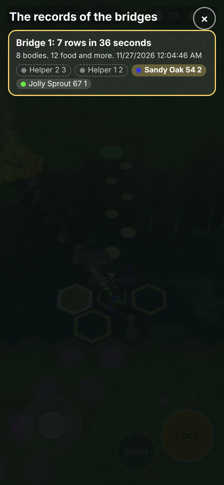 | 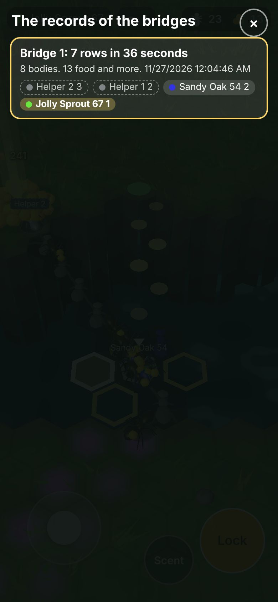 |

### 4. Demo mode

`?demo=1` on a new world: 4 helpers, no player, no input.

| Measure | Time after the load |
|---|---|
| First lock | 2.9 s |
| 1 locked body | 5 s |
| 4 locked bodies | 15 s |
| **The first bridge is complete (7 bodies)** | **26.8 s** (target: 15 to 45 seconds) |
| First food at the nest | 31.3 s |

The helpers lock in turn, one body each 4 seconds. A person can see each body go into the
bridge.

In the pictures, the bridge bodies are flat and grey, on dark plates, with straight legs
from body to body. The walkers are brown, higher, and have legs that bend. I think that a
person who sees one picture knows which bodies are the bridge. A person must confirm it.

| | | |
|---|---|---|
| 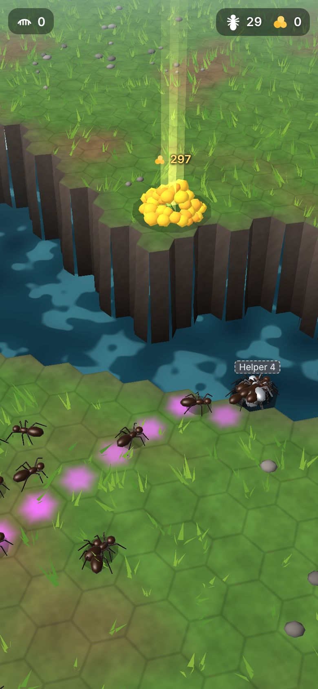 5 seconds | 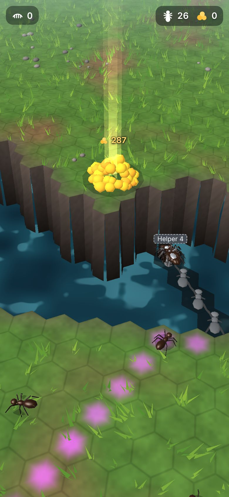 15 seconds | 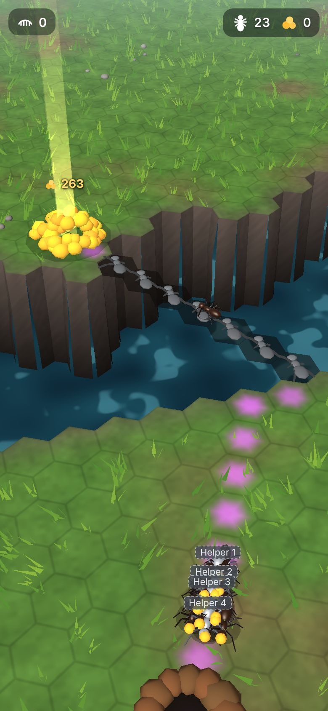 30 seconds |

### 5. The play session

**I could not start the workflow.** GitHub starts a workflow by hand only if its file is
on the default branch. The branch of this plan is not merged, and `main` has only a
README. The request to start `play-session.yml` on the branch gave "404 Not Found", and
GitHub lists 0 workflows for the repo.

To start a session, the two files `.github/workflows/play-session.yml` and
`scripts/play_session.sh` must be on `main`. Then "Run workflow" can use the branch
`feat/0002-players-are-the-bridge`. I did not push to `main`: the plan gives me this
branch only.

What I did as a replacement, on the test machine:

- I ran `scripts/play_session.sh` with 30 workers and 2 helpers for 2 minutes. It
  compiled the server in the production mode and started it.
- It got `cloudflared` and the SHA-256 was correct. `cloudflared` asked for a quick
  tunnel and got an address.
- **The tunnel did not connect.** The test machine has no way to the servers of the
  tunnel (`argotunnel.com` has no DNS answer there). Thus no person opened the game
  through a tunnel.
- I opened the page of that server at phone size and joined. The picture below is from
  that server.
- At the end, the script stopped the server with `TERM`. The directory of the artifact
  had `world.bin`, `server.log` and `records.json` with one record: 2 helpers, 6 bodies,
  6 rows, 44 seconds, 260 units of food.
- I changed the script after this run: the job now fails if the tunnel stops. The world
  file and the records are in the artifact all the same.

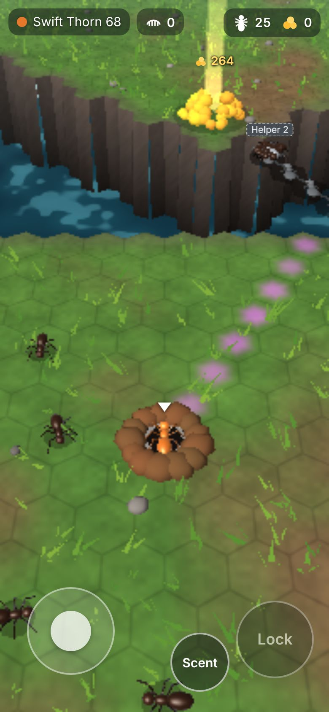

Not tested: the two actions of the workflow, the script on a runner of GitHub, and a
real tunnel. The hashes of the actions are those of the workflows in `sntran/BEAM.com`.

## TLA+ contracts

The contracts in [`specs/`](../../specs/README.md) have the rules of this plan. The
native TLA+ checker of accord looks at all the states of each model.

| Model | States | Time | Result |
|---|---|---|---|
| `Bridge`: a river 3 cells wide and 3 rows | 147 | 1.6 s | All rules hold |
| `BridgeWide`: 4 columns of 2, 3, 3 and 2 rows, lines of 4 bodies | 711 | 9.3 s | All rules hold |
| `BridgeOneWide`: the numbers of the plan, one cell wide | 8 | 0.1 s | No body after row 7 |
| `BridgeTwoWide`: the numbers of the plan, two cells wide | 3 | 0.1 s | Support to row 15, none in row 16 |
| `BridgeThreeWide`: the numbers of the plan, three cells wide | 4 | 0.4 s | Support to row 23, none in row 24 |
| `Colony`: a small river and one player | 433 | 2.7 s | All rules hold |

The rules that hold in each state or step:

- Each locked body has support.
- A new body never decreases the support of a body, and never increases a cost. Thus no
  body falls after a lock.
- No step removes a locked body.
- A free body is never in the river with no locked body below it.
- A player loses a body only by a lock. After a lock, the player has the body of a
  worker and cannot lock for a moment, or the player starts again at the nest.

The real world against the contract:

- **The monitor.** Two players send 220 random messages in each of 4 runs, with one
  helper and 5 workers in the world. Each message, each reply and each event is a step of
  `Colony.tla`. No run has a violation.
- **A wrong world.** With a wrong bank support in the world, the monitor reports the
  first wrong lock and blames the server.
- **Helpers on the grid of the game.** 30 locks of 4 helpers, to 3 piles, on the river of
  a seed: each lock is a step of the contract, and the bodies of the world are the bodies
  of the contract.

## The three faults of section 4.10

1. **`touch.up(id)` lifted the wrong finger.** The event `touchEnd` now has only the
   finger that goes up. All the play tests of this report use two thumbs.
2. **A "lock" with an `at` value that is not text stopped the channel.** The channel now
   replies "error" to each message with wrong data, and continues. A test sends wrong
   cells, text in the place of a map, wrong binary data and an unknown event.
3. **The message of the pile.** A player gets it at 2 cells from the center of the pile.

## Faults that I found and repaired

1. **No food went across at the later piles.** In the demo mode, the workers did not find
   the second pile. The helpers put scent only where they built. Now a helper goes one
   time from the nest to each new pile and puts scent.
2. **Workers went from one cell to the other and back at a corner of a bridge.** The rule
   was "go to the cell that is nearer to the pile". At a corner, no cell is nearer. The
   workers now use the shortest way on the cells where a body can be.
3. **The helpers built too fast.** With one lock each 4 seconds for each helper, the
   bridge of the demo mode was complete after 7 seconds. See "Numbers that I changed".
4. **Different seeds gave the same river.** The search for a good river used the seed in
   a wrong way. A test now compares the rivers of 10 seeds.
5. **The server refused small moves along the bank**, and the body of the player jumped
   back. A position on the edge of a cell was in the river for the server and on the bank
   for the page. The page now sends 3 decimals, and the server accepts 0.004 cells.
6. **After a lock, the new body jumped to the old place.** A move that the page sent
   before the reply of the lock arrived after it. The page now sends no move while it
   waits for the reply.
7. **The record button did not work with a thumb on the stick.** The browser makes no
   `click` event for a second finger. The buttons now use `pointerup`.
8. **The record card showed through the list of records.** The list now hides the card.
9. **The test of 12 rows crossed 11 rows.** See test 1.
10. **The session script continued with no tunnel.** See test 5.

## Things that can confuse a player

Most important first.

1. **Where is my body after a lock?** The camera goes to the new body in half a second.
   If the worker is far, the picture moves a long way, and the player must find the
   bridge again. Nothing shows the direction back to the bridge.
2. **Why is my new body so far away?** The player gets the nearest free worker. If no
   worker is near, the walk back is long. Nothing tells the player that scent brings
   workers to the bridge. This is the use of scent in this version, and it has no hint.
3. **The reach marks have no legend.** Yellow marks, a green mark on the far bank, and a
   small orange mark. I think that the green mark is clear. The orange mark that grows
   is not clear without a try.
4. **A third and a fourth body in a row help less and less.** The costs are 12, 6, 4
   and 3. The script made a row 4 bodies wide where 2 rows of 2 bodies are better. The
   marks show the reach of one cell at a time, thus the player cannot compare two cells
   without a move of the stick.
5. **No sign when the colony has no worker.** After a lock with no free worker, the
   player has no body for 3 seconds. The camera goes slowly to the nest. The page shows
   no count and no message. The number of free workers at the top is 0, and that is all.
6. **The pile loses units and the player does not know why.** The number above the pile
   goes down from the first lock. Nothing tells that a fast bridge keeps more food.
7. **The record card is short.** 5 seconds is not much time for 4 lines of text when the
   player is busy. The button with the bridge sign opens the list, but the sign has no
   label.
8. **The first record can come with no work of the player.** With helpers, a bridge can
   be complete before a new player locks one body. Then the player sees no card.
9. **Not all my bodies are in the record.** The record counts the bodies of the bridge
   at the first food. A body that I lock later, or a body that does not touch the bridge,
   is not in the count. In test 3, a player locked 2 bodies and the record shows 1.
10. **The next pile appears far away.** The light shows it, but the camera of a phone
    shows a small part of the far bank. A player at the old bridge can miss it.
11. **"You are at the food"** is a message of plan 0001. It tells the time from the load.
    It shows at the same moment as the record card, and the two say different things.
12. **Helpers look as workers from far away.** A helper is grey and has a label. A worker
    is brown. On a small screen the difference is small until the helper locks.

## Risks for the design

1. **After the first bridge, the later piles do not need a new bridge.** The far bank is
   one piece of land. A body can cross the first bridge, 5 or 6 rows wide, and walk along
   the far bank to each later pile. A player with scent can lead the workers there. Then
   the piles across 9, 12, 14 and 16 rows give food with no wider bridge, and the support
   rule after row 7 has no use. The helpers do not do this: they build a new bridge near
   each pile. The script did not do it also. A person will find it quickly.

   I made sure of this with the world and no browser. One player made the first bridge
   of 6 bodies and put scent to the first pile. When the second pile appeared across a
   place 9 rows wide, the player went along the far bank to it with scent and did not
   lock. The food of the second pile came to the nest. The world made a second record: 6
   bodies, 6 rows, 49 seconds. It is the first bridge again.

   The plan does not decide this, and I changed nothing. Options for the next plan: parts
   of the far bank that do not touch each other, a time limit for each pile, or food that
   a worker can carry only a limited distance.
2. **The loop of a builder at a far place is mostly a walk.** See test 1: about 10
   seconds for each body, and 1 decision.
3. **A good first bridge is easy.** 6 bodies in a straight line, 13 seconds. The first
   place has no problem to solve. The problem of the support starts at the second pile,
   and risk 1 lets the player go around it.
4. **Thirty workers are few for a wide bridge.** A bridge across 12 rows uses 19 to 22
   bodies. While workers carry food, the nest makes new workers: 1 for each 10 units.
   With no food flow, the nest makes 1 worker each 10 seconds only below 5 workers.
5. **Locked bodies stay for all time.** Nothing removes a body (section 7). A wrong
   bridge stays in the river and in the save file. With many players the river fills.

## Numbers that I changed

| Number | Plan | Now | Cause |
|---|---|---|---|
| Seconds between the locks of one helper | 4 | 16 | With 4, the 4 helpers of the demo mode completed the first bridge in 7 seconds. The plan wants 15 to 45. The helpers also lock in turn. Thus 4 helpers make one lock each 4 seconds. |

All the other numbers of section 4 are in `config/game.exs` with the values of the plan.
The rule "a helper locks one time each 4 seconds at most" is still true.

Things that I added and the plan does not ask for: the helpers put scent and show the
way to each pile, the workers wait at the end of a bridge near scent, and the reach has
an orange mark for the first row that the bridge cannot get to. `docs/decisions.md` has
all the decisions, items 61 to 112.

## Other results

- The first load is 50 KB after compression: one HTML file (3 KB), 9 JavaScript files of
  the game (33 KB) and the channel client of Phoenix (14 KB).
- `mix accord.check` still does not read `CHECK_DEADLOCK FALSE`. `mix colony.contracts`
  calls the checker directly.

## What this version tells me about the three questions

1. **Is it fun to be the bridge, alone, in the first 2 minutes?** The tests cannot answer
   this. They show that the first 20 seconds work: 6 locks, one each 1.5 seconds, each
   with a new body near the bridge, then food and a record with my name. That is much
   faster than the 3 minutes of plan 0001. After that, the second pile is the test of the
   fun, and risk 1 can remove it.
2. **Do 5 to 20 persons build together with no chat?** Not tested with persons. Two
   browsers and helpers build one bridge, and the record has all the names. The server
   has room for 20 players. The play session is the tool for this test, and it has not
   run.
3. **Does a person want to see the record of a bridge with their name?** Not tested with
   persons. The record, the card and the list work, and the artifact of a session has the
   records as JSON.
