# Play test 0003: The crossing

This is the report of the tests of [plan 0003](../plans/0003-the-crossing.md), section 5.
The decisions that the plan does not make are items 113 to 164 of
[`docs/decisions.md`](../decisions.md).

## Summary

| Target | Result |
|---|---|
| `mix test` shows the results of section 5.1 | **Met.** 99 tests, all pass. |
| The TLA+ contracts have the new rules | **Met.** 8 models, 1,831 states, all rules hold. |
| Tick time, 95th percentile, 50 ms or less (1,000 workers, 20 clients, 8 helpers) | **Met.** 2.5 ms. |
| Each client gets 30 KB each second or less | **Met.** 5.4 KB. |
| New player alone: the first food in less than 60 seconds from the load | **Met.** 13.2 s. |
| New player alone: the four crossings | **Met.** After 7, 30, 64 and 145 seconds. The world is complete after about 3 minutes. |
| New player alone: the bodies are not more than the row "Random" | **Met.** 5 of 5, 16 of 18, 19 of 22 and 38 of 42. |
| New player alone: never more than 20 seconds with no spare body | **Met.** 0 seconds. |
| A player who never locks carries food 5 times, and the record counts it | **Met.** 50 units in the record of river 2. |
| One player and 3 helpers: the record has the names | **Met.** |
| One player and 3 helpers: each lock gives a body 3 cells or less away | **Not met.** 13 of 14 locks. One lock gave a body 3.6 cells away. See test 3. |
| Two browsers: the same record and the same story | **Met.** |
| 20 new players complete the four crossings | **Met**, but slowly: the world is complete after 667 seconds. See test 5. |
| The story: all the bodies appear in order, and the PNG file has the names | **Met.** 78 bodies in 24.4 s. |
| Sound: one note for each lock, the song at each crossing, no error with no sound | **Met.** 78 notes for 78 locks, 4 songs. |
| The play session: put the workflow on `main` and start it one time for 5 minutes | **Met.** The run was a success. No person joined: see test 8. |
| The first load is 100 KB or less | **Met.** 71 KB. |

The number that the plan lets me change: **3 units of food make one worker**, not 5.

## What these tests do not show

Read this first.

- **A script played, not a person.** The script of the new player is exactly the script of
  section 5.3. It makes one lock each 1.3 seconds and never stops to look. Its times are
  the shortest times that are possible. A new person is slower.
- **No test tells if a lock feels good**, if the sound is good, or if the game is fun.
  The tests show that each part is there and does what the plan says. Items 2, 5 and 6
  of section 8 need you and other persons.
- **No real phone.** The test machine has no graphics card: Chromium draws with software.
  I did not measure 60 frames each second. The rule "fewer pixels when a frame takes more
  than 20 milliseconds" is in the page, and `?stats=1` shows the frame time. You must
  measure on your phone.
- **Nobody heard the sound.** The test machine has no speaker. The page counted the notes.
- **The phone did not shake, and the share function did not open.** Chromium on the test
  machine has no vibration and cannot share a file. The button saved the PNG file.
- **The play session ran with no player.** The workflow started two times, the tunnel
  gave an address, the address answered on the runner, and the artifact was there. Nobody
  opened the address on a phone or on a different computer.
- **The browser tests use one world**: seed 2027. The automatic tests use other seeds.
- **The 20 clients have no browser.** They use the code of the page and the same script.
  They never carry food, because the script does not: see test 5.

## 5.1 Automatic tests

`mix test`: 99 tests pass, in about 150 seconds.

| # | Result of the plan | Result |
|---|---|---|
| 1 | No player and no helper: no lock in 5 minutes, the workers wait at the crossing place | **Met.** 3 seeds. All 30 workers wait at the edge of land 0, one on each cell. |
| 2 | One body locks 6 times across river 1; food in less than 20 seconds after the crossing | **Met.** 8.5 seconds. |
| 3 | The table of section 4.5 | **Met** for "Best". "Random" is different: see below. |
| 4 | A lock into a cell that is not open, and a lock with no spare body, get "error" | **Met.** |
| 5 | Two bodies lock into the same cell in the same tick: one gets the cell | **Met.** One spare body is used. |
| 6 | No way around, for 40 seeds | **Met.** From each land, a body gets to each cell of that land and to no other land. |
| 7 | The piles: place, size, loss, the limit of 50 units, the next pile at the crossing | **Met.** |
| 8 | A player carries 10 units to the nest, and the new workers are there | **Met.** |
| 9 | Four helpers and no player complete the four crossings | **Met.** River 1 after 18 s with 5 bodies, river 2 after 86 s with 17 bodies, river 3 after 199 s with 28 bodies, river 4 after 372 s with 43 bodies. The world is complete after 399 s of world time. The helpers lock in turn, one lock each 4 seconds. |
| 10 | The world is complete at the first food of pile 4; save and load keep the world | **Met.** |
| 11 | The contracts | **Met.** See "TLA+ contracts". |

### The table of section 4.5

`test/open_test.exs` builds a bridge on a river with one width, with the rule of the
server.

| Width | 5 | 6 | 7 | 8 | 9 | 10 | 11 | 12 | 13 | 14 | 16 | 17 | 18 |
|---|---|---|---|---|---|---|---|---|---|---|---|---|---|
| Best, the plan | 5 | 6 | 7 | 8 | 10 | 13 | 16 | 19 | 22 | 25 | 31 | 36 | 41 |
| Best, my test | 5 | 6 | 7 | 8 | 10 | 13 | 16 | 19 | 22 | 25 | 31 | 36 | 41 |
| Random, the plan (highest of 25) | 5 | 6 | 7 | 8 | 10 | 14 | 18 | 22 | 27 | 30 | 42 | 47 | 51 |
| Random, my test (highest of 25) | 5 | 6 | 7 | 8 | 10 | 13 | 17 | 22 | 26 | 33 | 42 | 48 | 51 |
| Random, my test (highest of 200) | 5 | 6 | 7 | 8 | 10 | 13 | 19 | 23 | 28 | 34 | 43 | 48 | 54 |

- **"Best" is the same.** Thus my rule is your rule.
- **"Random" is different because the runs are random.** The highest of 25 runs changes
  with the random numbers. At width 10, a bridge has 13 bodies in 2,959 of 3,000 runs
  and 14 bodies in 41 runs. Your 25 runs had one of the 14. My 25 runs had none.
- **The row "Random" of the plan is not a limit.** In 200 runs, a random player uses 34
  bodies at width 14 and 54 at width 18. A person who taps each time the button is
  bright can thus use more bodies than the row.
- **No run stopped before the far land**: 13 widths, 225 runs each. The contract
  `BridgeOpen` and `BridgeNineRows` check the same for all the bridges of two small
  rivers.

## 5.2 Load test

`mix colony.load`: 1,000 workers, 20 clients and 8 helpers for 5 minutes, in the world with
four rivers.

| | Result | Target |
|---|---|---|
| Ticks of the server | 3,000 in 300 s: 10.0 each second | 10 |
| Tick time, median | 1.31 ms | |
| Tick time, 95th percentile | **2.47 ms** | **Met**: 50 ms or less |
| Tick time, 99th percentile | 5.09 ms | |
| Tick time, maximum | 13.34 ms | |
| Memory of the VM, maximum | 65.5 MB | |
| Bytes each second for each client | **5,446** | **Met**: 30,000 or less |
| Ticks each second that a client got | 10.0 | |

In the 5 minutes, the 8 helpers made the four crossings with 90 bodies, and the workers
carried 1,613 units of food to the nest. The 20 clients moved near the nest.

## 5.3 Play tests

`node test/play/run.mjs` does these tests in Chromium at 390 x 844 with real touch
events. The pictures are in [`0003/`](0003/).

### 1. A new player alone

30 workers, no helper. The script of the new player plays to the end of the world.

| | Result |
|---|---|
| The first food at the nest | **Met.** 13.2 s from the load (the target is less than 60 s). |
| The four crossings | **Met.** |
| The bodies of each bridge | **Met.** |
| No long wait | **Met.** The colony always had a spare body: 19 or more at each crossing. |
| The first four locks | After 2.1, 3.3, 4.7 and 6.0 seconds: one lock each 1.3 seconds on river 1. |
| The longest time between two locks | 6.9 seconds: the walk to the next river. |
| Locks that the server refused, and moves that the server refused | 0 and 0. |

| River | Crossing after | Bodies | Widest column | "Random" of the plan | Food left in the pile | Spare bodies |
|---|---|---|---|---|---|---|
| 1 | 7 s | 5 | 5 rows | 5 | 293 of 300 | 25 |
| 2 | 30 s | 16 | 11 rows | 18 | 377 of 400 | 19 |
| 3 | 64 s | 19 | 12 rows | 22 | 466 of 500 | 22 |
| 4 | 145 s | 38 | 16 rows | 42 | 519 of 600 | 32 |

The world was complete about 30 seconds after the last crossing: the workers carry the
first food of pile 4 across all the world. Then the page showed the story.

I ran this test 6 times while I worked. The bodies of the four bridges were 5, 13 to 18,
19 to 30 and 36 to 44. All were at the row "Random" or below it. One run had 30 bodies at
a width of 14: exactly the row.

**With 5 units of food for each worker, the game is slow at the end.** In a run with 5,
the bridge of river 4 had 48 bodies after 377 seconds and was not complete, and the
colony had 4 spare bodies. The player did not wait 20 seconds, because the nest makes one
worker each 10 seconds. But each new worker is at the nest, the lock uses it immediately,
and the new body of the player is then 60 rows from the bridge. With 3 units the colony
grows while the player builds: the same bridge is complete after 145 seconds.

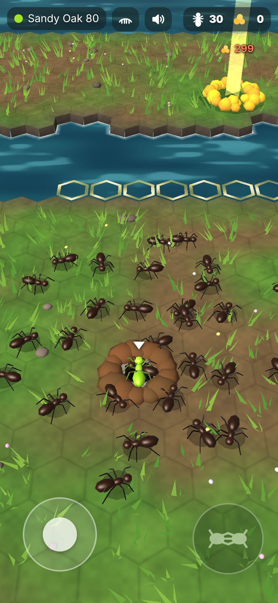

### 2. A player who never locks

3 helpers. The player waited for the crossing of river 1, then walked to pile 1 and to the
nest 5 times. **Met.**

- Each trip took 10 units: 50 units.
- The record of river 2 has the player with 0 bodies and 50 food. The story has the same.
- The page had no error.

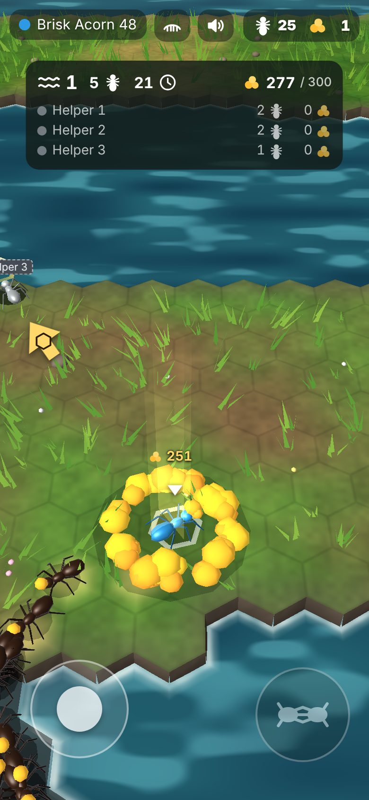

### 3. One player and 3 helpers

The new player and 3 helpers built across river 1 and river 2.

- **Met: the record has the names.** The record of river 1 has the player and helpers.
- **Not met: each lock gives a new body 3 cells or less from the locked body.**
  The player made 14 locks. The distances to the new bodies, in cells: 1.0, 1.0, 1.0, 1.0,
  1.0, 1.0, 1.7, 1.0, 1.0, 2.0, 1.0, **3.6**, 1.7 and 1.0. 13 locks gave a body 3 cells or
  less away. One lock gave a body 3.6 cells away: the first lock beside the bridge of
  river 2. In the runs before my last changes, that lock was 4.6 to 7.2 cells away.

Why one lock is far: on river 2 the script makes 7 locks forward in 9 seconds. One worker
of each three waits at the bridge: 8 workers. The script uses them faster than new
workers come from the piles. The next lock gets a worker that is on its way.

What I changed for this target:

- The workers wait on each cell that touches an open cell (decision 126). Before this,
  they waited only at the top of the bridge, and a lock at a low row got a body from the
  top.
- With no bridge, the workers wait below all the open cells, 6 columns to each side of
  the pile, not 3 (decision 115). Before this, the first lock of a bridge got a body 5 to
  8 cells away.
- The worker that starts to wait is the worker nearest to the bridge (decision 127).

What I tried and did not keep: **one worker of each two waits.** Then all 14 locks were 3
cells or less away. But the colony got less food: the player alone was at river 4 with 9
spare bodies, then with 2, and made 8 locks in one minute. I went back to one of each
three.

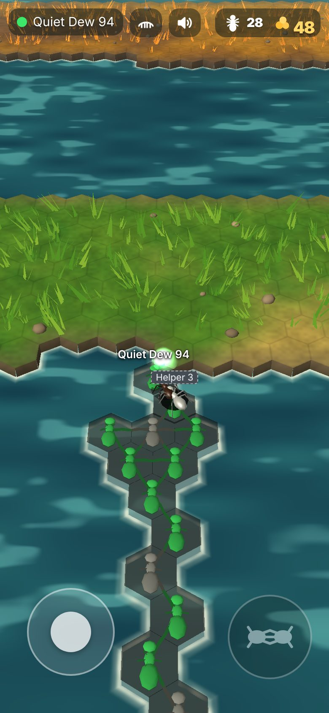

### 4. Two browsers

Two new players at the same time, no helper. **Met.**

- The two players have different names.
- The record of river 1 is the same in the two browsers. It has the two names: 3 bodies
  and 2 bodies.
- The story is the same in the two browsers: the same 5 locks in the same order.

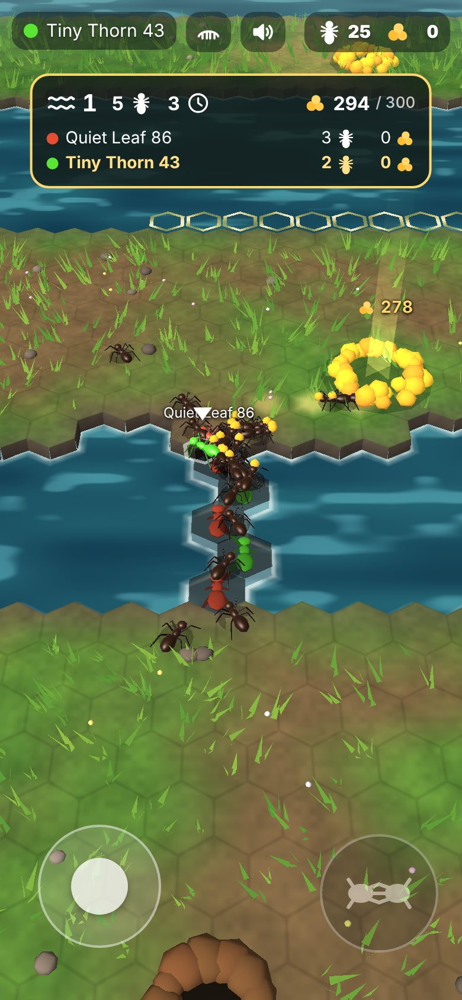

### 5. Twenty new players

20 clients with the script of the new player and no browser, 30 workers, no helper.

**Met: the clients complete the four crossings.** The world is complete after 667 seconds.

| River | Crossing after | Bodies | Widest column | Food left in the pile |
|---|---|---|---|---|
| 1 | 3 s | 5 | 5 rows | 298 of 300 |
| 2 | 8 s | 16 | 11 rows | 395 of 400 |
| 3 | 124 s | 23 | 14 rows | 383 of 500 |
| 4 | 584 s | 46 | 18 rows | 140 of 600 |

- **No client got no lock.** Each of the 20 clients made 3 to 7 locks: 7, 6, 6, 5, 5, 4,
  5, 5, 5, 4, 4, 4, 4, 4, 5, 4, 4, 3, 3 and 3. That is 90 locks.
- **No client carried food.** Each client has 0 units.
- The first food was at the nest after 8.8 seconds.
- The longest time with no spare body was 9.9 seconds: the time of the nest for one
  worker. But from second 20 to the end, the colony had 0 spare bodies almost all the
  time, and each client waited for its turn: about 3 minutes between two locks of one
  client.

**Why it is slow.** The 20 players use the 30 spare bodies in 20 seconds. After that, the
colony has no worker that carries food. The nest makes one worker each 10 seconds, and
one player locks with it immediately. The colony stays at 0 spare bodies to the end.

**The script does not carry food.** A player at the bridge sees an open cell on the
screen, and the script pushes to it. The arrow to the pile shows only when the colony has
no spare body, and the script reads the arrow only when no open cell is on the screen.
A person who sees the number flash at 0 can go for food. I do not know if a person does.
This is the largest risk of the plan for 5 to 20 players: see "Risks".

### 6. The story

The server loaded the world of test 1. The page was `/?story=1`. **Met.**

- The page had no body in the world.
- 78 bodies appeared, each in the order of its lock, in 24.4 seconds.
- The first body of the player showed the name.
- The picture is a PNG file of 758 x 1211 pixels. It has the date and the name with 78
  bodies and 0 food. The page gave the test the list of the names that it wrote into the
  picture: I did not read the text from the pixels.
- A tap on the button saved the file `colony-2026-11-27.png`.

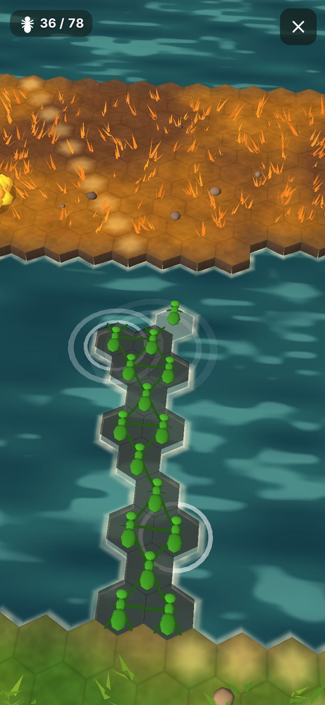
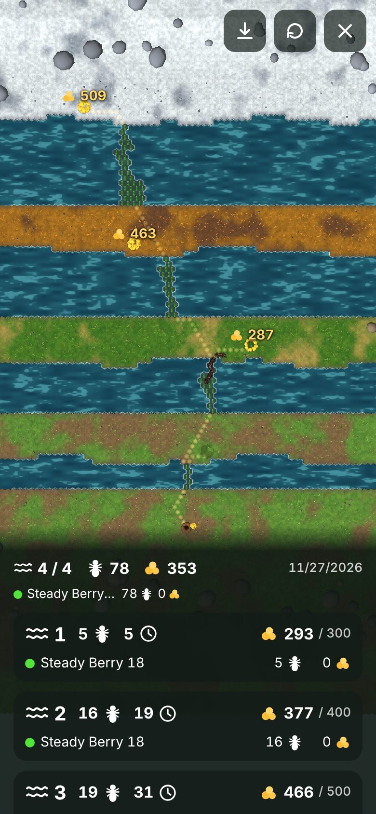
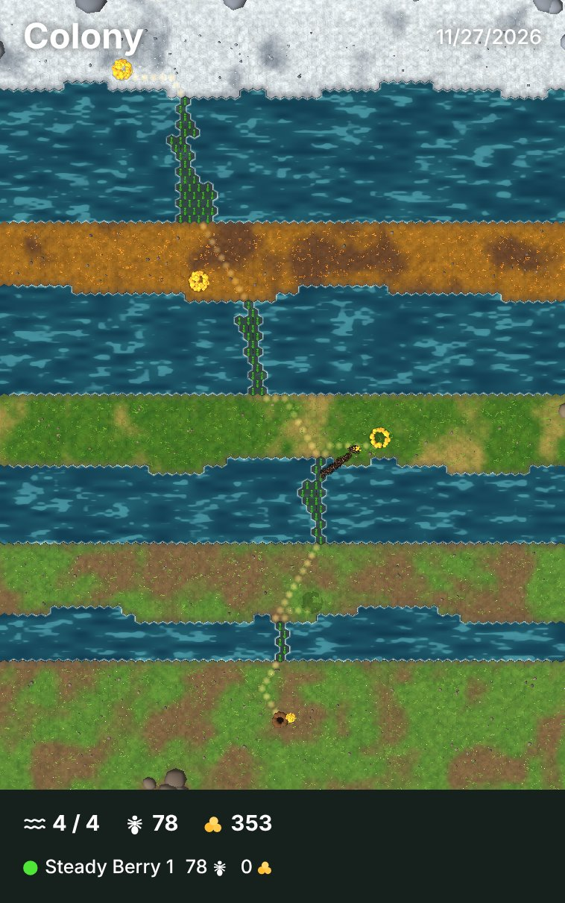

The last picture is a JPEG copy of the PNG file of the test.

### 7. Sound

**Met.**

- In test 1, the page played 78 lock notes for 78 locks, and no note was dropped. It
  played 4 songs with 78 notes and 4 chords: one song for each crossing.
- A browser with no Web Audio API: the script made 5 locks and crossed river 1. The page
  had no error and counted 0 notes.
- The sound starts at the first touch. The button stops and starts it.

### 8. The play session

**Met: the workflow is on `main`, and a run of 5 minutes was a success.**

- The commit `6e6155c` on `main` has only `.github/workflows/play-session.yml`.
- I started the workflow with the branch `feat/0003-the-crossing`, 5 minutes, 30 workers
  and 0 helpers: [run 45934573855](https://github.com/sntran/Colony/actions/runs/45934573855).
- 03:30:47 UTC: the step started. 03:30:58: the server ran in the production mode with a
  new world. 03:32:02: the tunnel gave an address and the address answered with the page
  on the runner. 03:37:02: the time was at its end. The job saved the world file, the
  records and the log as an artifact.
- From the start of the job to the address: 83 seconds.

I started the workflow a second time after the last change of the code, to make sure
that the final game starts on a runner:
[run 45939720692](https://github.com/sntran/Colony/actions/runs/45939720692). It was a
success also: the session ran for 5 minutes and saved its artifact.

I could not open the address from the test machine: GitHub gives the log of a job, with
the address, only after the job is at its end.

What this does not show: no player joined. The world file of the run has no body.

### The moments

The test `moments` plays as the new player and stops the time of the page for each picture.

**A lock (4.8).** The body is down in its cell, the light flies to the new body, and the
button is bright again. Then the name shows above the locked body and a ring goes out on
the water.

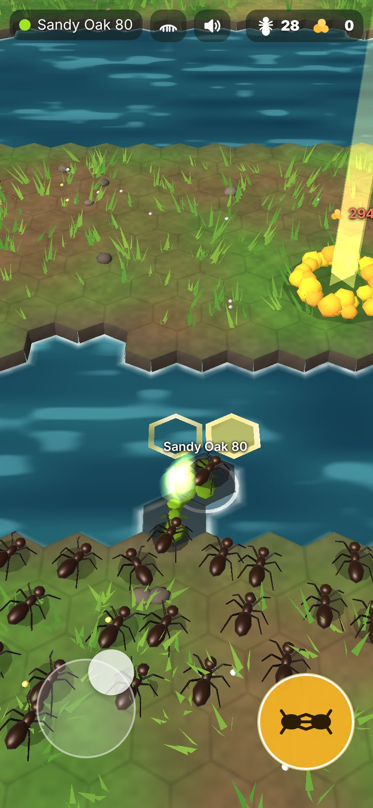
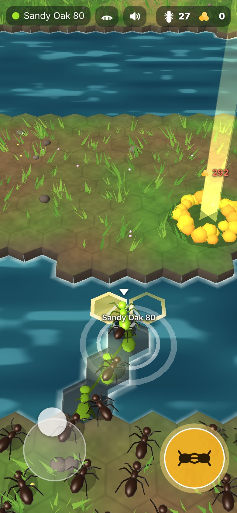
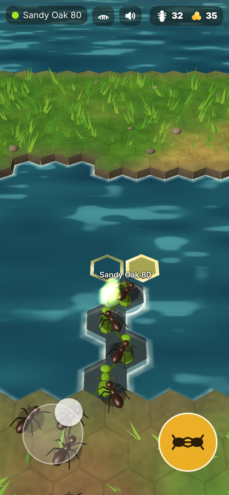

**A crossing (4.9).** The camera moves back and shows the full bridge. The workers that
waited go across in a line. Then the record card shows, and the arrow points to the next
open cells.

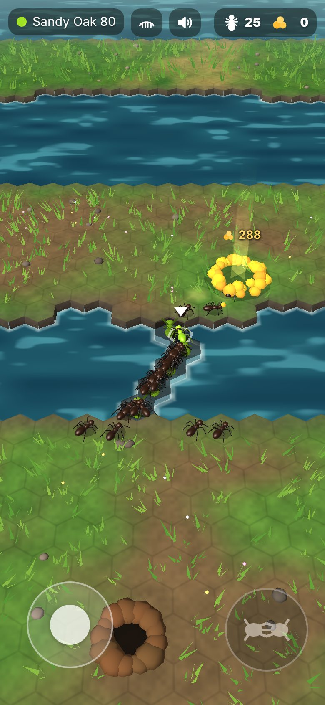
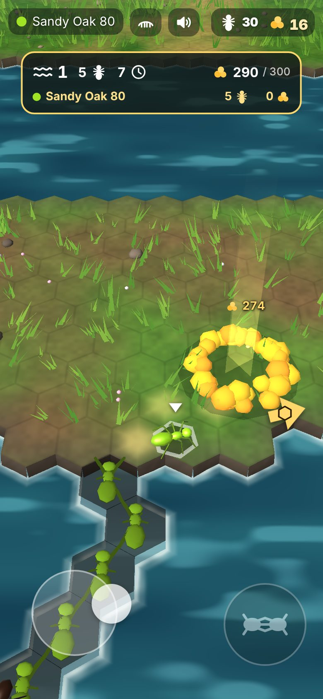
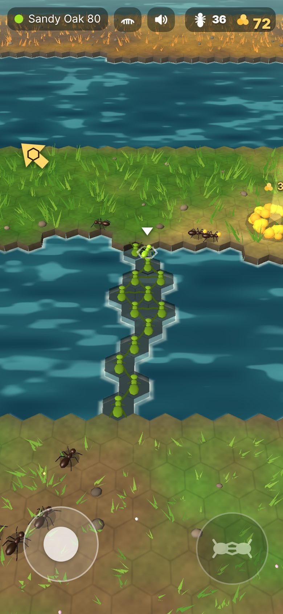
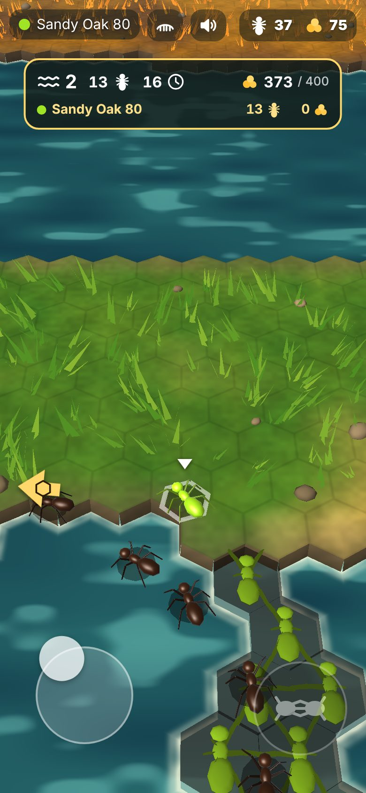
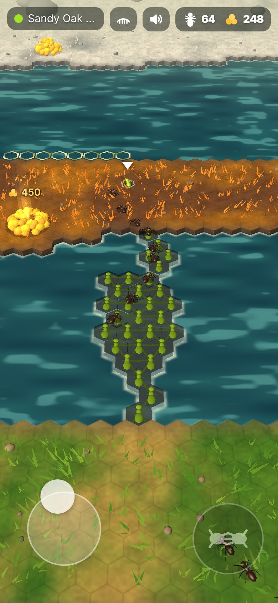
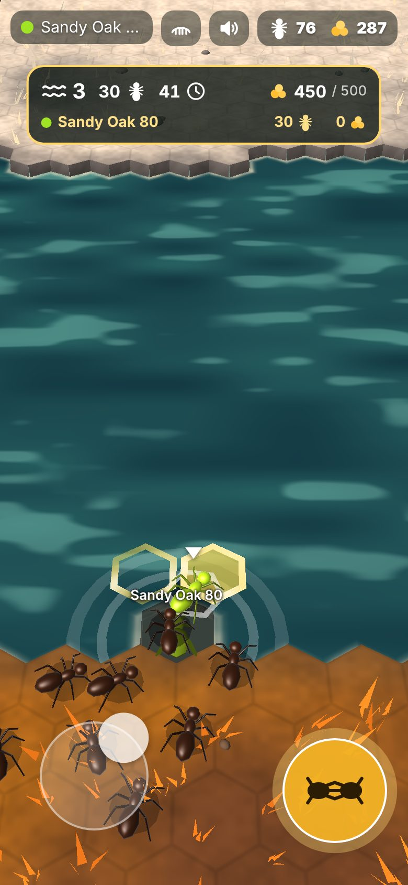
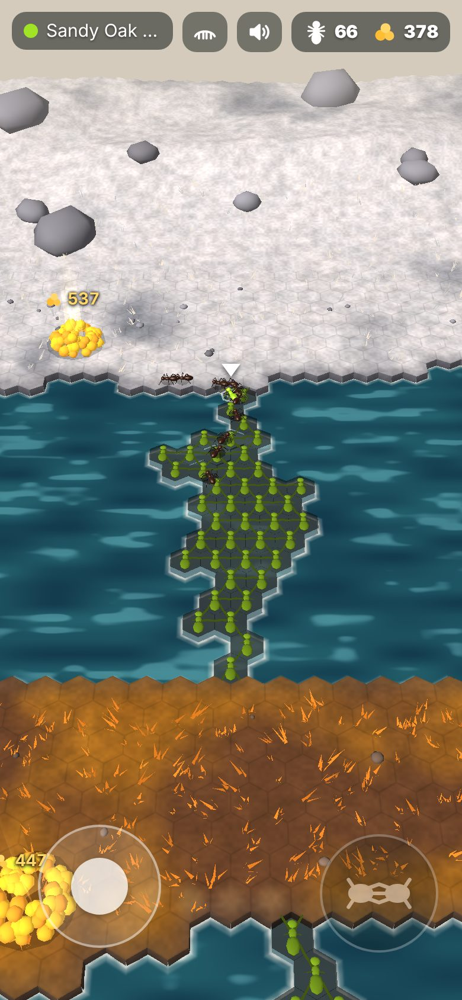
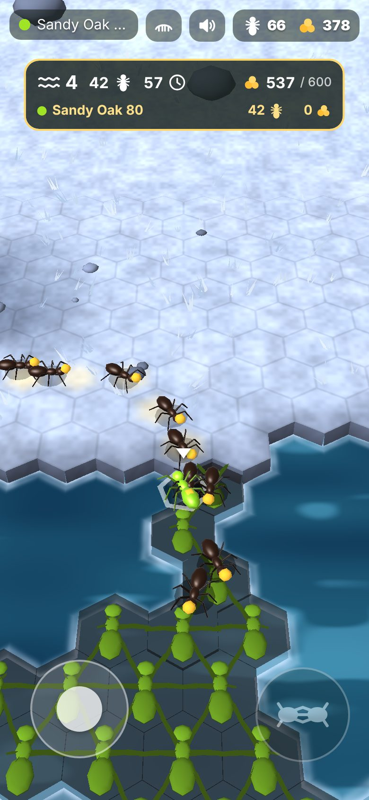

**The lands.** Spring, summer, autumn and winter.

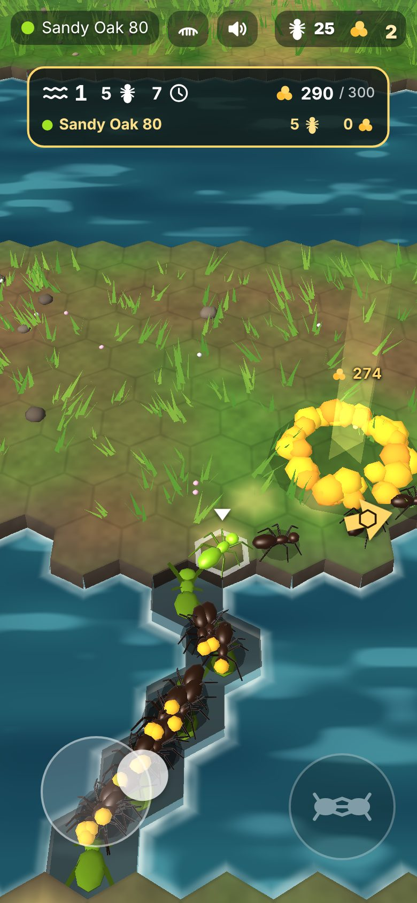
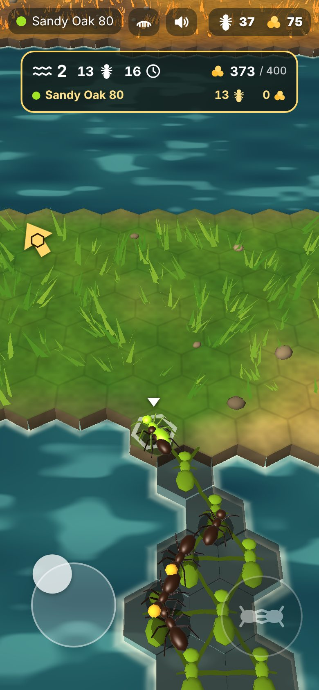
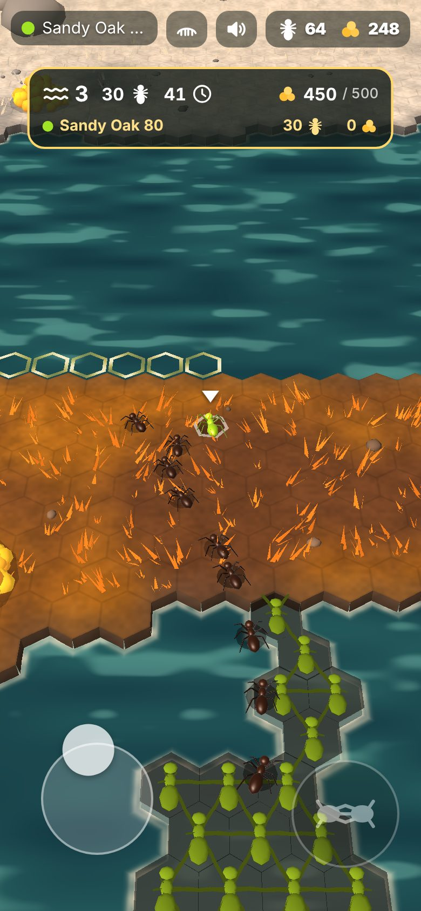
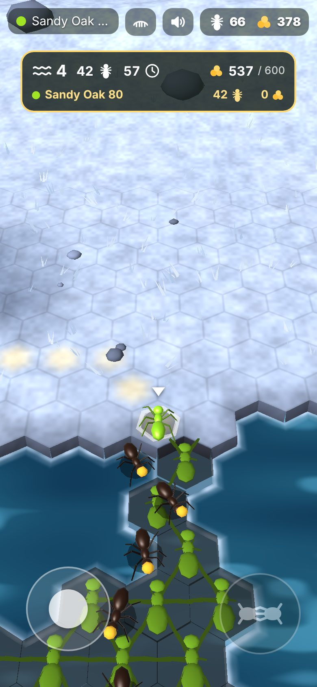

**The story after the last crossing.**

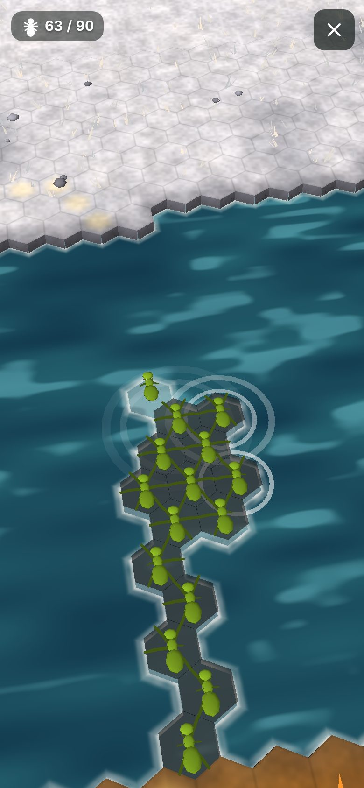

## TLA+ contracts

`mix colony.contracts` checks 8 models. All the rules hold.

| Model | States | What it checks |
|---|---|---|
| `Bridge` | 147 | The support rule in all the structures of a river 3 cells wide. |
| `BridgeWide` | 711 | The same with lines of 4 bodies. |
| `BridgeOpen` | 29 | The open cells: one bridge, forward first, a complete bridge takes no more bodies, no bridge stops before the far land, each bridge has 4 bodies. |
| `BridgeOneWide` | 8 | One body wide stops at 7 rows. |
| `BridgeTwoWide` | 3 | Two bodies wide stops at 15 rows. |
| `BridgeThreeWide` | 4 | Three bodies wide stops at 23 rows. |
| `BridgeNineRows` | 632 | The numbers of the plan: each bridge across 9 rows has 10 bodies. |
| `Colony` | 297 | A player and the world: a lock needs a spare body and an open cell, and uses one spare body. A player always has a body. |

The tests follow the real world against the contracts:

- 4 runs of 220 random messages of two players, with a helper. Each message, each reply
  and each event is a step of `Colony.tla`. The monitor compares the locked bodies, the
  number of spare bodies and the body of each player after each message.
- A world with a wrong support rule: the monitor finds the first lock into a cell that is
  not open, and blames the server.
- 4 helpers build across river 1 and river 2 of the game: 19 locks, each a step of the
  contract of its river.

## Faults that I found and repaired

1. **One worker number two times in one message.** A lock removed a worker, and the nest
   made a worker with the same number in the same tick. The page then lost that worker.
   The test that compares a client with the world found it.
2. **The world did not get complete.** The workers go to the nearest pile. From the nest
   that is pile 1. No worker went to pile 4. Now a new pile calls workers (decision 128).
3. **With no worker at the last crossing, the world did not get complete.** The 20
   players used each worker. The call of a pile now stays until its first food is at the
   nest.
4. **The body of the script stopped on a side body of a wide row.** It pushed north to the
   open cells, with water in front. The push to each side brought it back. Now the body
   goes around a corner when the push is blocked (decision 136).
5. **The body took food by accident and stopped.** The straight way of the arrow went
   across the pile. The body took 10 units, the arrow pointed to the nest, and with the
   nest on the screen there was no arrow. Now the way does not go across a pile, a player
   takes food only near the center of the pile, and the order of the arrow rules is the
   order of the plan.
6. **The body stood on the pile cell for 63 seconds.** The page had no way from a pile
   cell. The body moved again when the pile was empty. Repaired.
7. **A lock at a low row of a bridge gave a body from the top.** The workers waited only
   at the top of the bridge. Now they wait beside each open cell.
8. **My test tool left a server alive**, and the next test played in an old world. Two
   wrong results came from this. The tool now waits until the port is free.

## Things that can confuse a player

1. **Pile 1 loses units before the first player comes.** The loss starts at the first
   tick of the world, as the plan says. A server that waits one minute has 240 units. A
   server that waits 5 minutes has 50. In a play session, the players open the address
   one minute or more after the start.
2. **The arrow is not there when its target is on the screen.** A player who carries food
   and sees the nest gets no sign. The script stops there. A person must know that the
   food goes to the nest.
3. **The arrow points to an open cell while I carry food**, if the colony has a spare
   body. This is the order of the plan. A lock then loses the food, and nothing tells
   this before the lock.
4. **The button is not bright for three different causes**: the colony has no spare body
   (the number flashes), my new body rests for 1 second (no sign), or my cell does not
   touch an open cell.
5. **In the "wider" phase many cells are open, and all look the same.** Some help more
   than others. A player who takes the nearest cell uses more bodies.
6. **With no spare body, the open cells stay on the screen with a weak edge.** A player
   can stand there and wait. Nothing says "carry food" except the arrow, and the arrow
   shows only when the pile is not on the screen.
7. **After a lock on a wide bridge, the new body can be on a side body.** A push to the
   open cells then goes around the corner. The player did not steer that.
8. **The camera moves back at a crossing.** If the thumb holds the stick, the body walks
   while the camera is far. A change of the stick stops the camera.
9. **The record card has no words.** "293 / 300" with the food sign is the food that was
   left in the pile. A new person can read it as food at the nest.
10. **The pile number is red while the pile loses units.** Nothing tells why it is red.
11. **After the last crossing, nothing shows that the world waits for the first food of
    pile 4.** The story starts about 35 seconds later, with no question.
12. **While the story plays, the body does not move.** The cross closes the story: the
    first tap goes to the end, the second tap closes.
13. **A tap on my name gives a new name immediately.** My old locked bodies keep the old
    name. I can think that they are the bodies of a different person.
14. **After the last crossing, the button is never bright.** The player can walk, carry
    food and look.
15. **A helper has a grey name in a box.** Nothing says what a helper is.

## Risks for the design

1. **20 players and 30 workers.** The spare bodies are gone in 20 seconds. Then all the
   players together make one lock each 10 seconds, unless persons carry food. A player
   who carries 10 units gives the colony 3 workers. The test cannot show if persons do
   this. Options for the next plan: more workers at the start for each player, a nest
   that makes workers faster with more players, or a stronger sign for "carry food".
2. **A fast player completes the world in 3 minutes.** The script is faster than a
   person. But the four rivers are not ten minutes for a person who knows the game.
3. **With 3 units for each worker, the colony grows fast when nobody locks.** After the
   last crossing it has 200 workers in two minutes. With 5 units, a fast builder has no
   spare bodies at river 4. A number between them, or a number that changes with the
   river, can be better. I did not test that.
4. **A player who uses the waiting workers faster than they come** gets a body some cells
   away: see test 3.
5. **The end is quiet.** After the last crossing there is no work for a builder.

## Numbers that I changed

| Number | The plan | Now | Why |
|---|---|---|---|
| `food_per_worker` | 5 | 3 | Test 1: with 5, the colony has 4 spare bodies at river 4. |
| `food_touch` | "touches" | 0.75 cells | A body beside a pile took food by accident. |
| The workers wait, with no bridge | 3 columns to each side | 6 columns to each side | Test 3: the first lock of a bridge got a far body. |

## Other results

- **The first load** is 71 KB with gzip: one HTML file, 15 JavaScript modules and the
  Phoenix client. There are no image, model, font or sound files.
- **The tick messages** of 1,000 workers and 8 helpers are 3.0 KB each second.

## What this version tells me about section 8

1. *I start a play session from my phone.* The workflow is on `main` and one run was a
   success. You can start it from the page Actions.
2. *I get the first food in less than 60 seconds, with no instructions.* The script got
   it after 13 seconds. The workers are at the river before the player, the open cells
   show, and one button is bright. A person must show this.
3. *I complete the four crossings alone and never wait more than 20 seconds.* The script
   did. A person is slower, and the colony then has more workers, not fewer.
4. *I see the story with my name and I save the picture.* The test did both. On a phone,
   the button opens the share function: I did not test that.
5. *The game has sound, and each lock feels good.* The sound is there and the page counts
   it. I cannot tell how it feels.
6. *One bridge has the names of two persons or more.* Two browsers did this. Persons did
   not.
